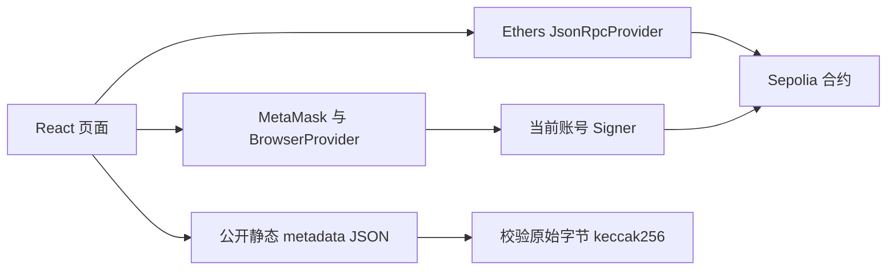

# Final Project 完整执行计划

更新日期：2026-10-28。状态：前端已实施；15 项自动测试、本地链 UI 全流程和 Sepolia 只读验证已完成。最终签名测试网流程与课程提交待补。代码基线：`21ad35e`，接口交接：`fc728cb`。

目标是在既定八项 MVP 内完成可运行的志愿服务时长 DApp，并交齐课程要求的代码、README、英文演示和 PDF 报告。产品范围见 [plan.md](plan.md)，逐项要求及可行性审核见 [plan_review_2026-10-28.md](plan_review_2026-10-28.md)，待补资料与执行状态见 [integration_status.md](../handoff/integration_status.md)。

## 1. 计划基线与完成定义

原计划基线存在缺入口/占位符的构建失败；本轮已恢复入口并实现业务前端，安装、15 项测试和生产构建通过。真实 Sepolia code/getter/浏览器读取已核查；钱包签名和部署 tx 仍缺。原计划的阶段退出条件继续作为最终验收标准，不把本地链交易充当新 Sepolia 交易。

用户随后明确授权完整执行，并确认朋友负责合约/部署、我方负责前端。本轮已完成可执行的前端和本地验证，生成报告与英文证据讲解草稿。下文为最初计划与验收标准，实际阶段状态以 integration_status 和 browser_acceptance 为准。身份信息最后补，未做远端推送或课程平台提交。

项目完成必须同时满足：

1. 新环境按 README 能安装、配置、构建并运行；真实浏览器没有阻断主流程的错误。
2. 八项 MVP 均通过界面调用真实测试网合约，状态与合约查询一致。
3. 至少一条有意义的状态修改有测试网交易与确认后数据证据；不能用静态假数据充当链上成功。
4. 提交可播放、英文、15 分钟以内的高清 MP4/MOV；提交 PDF 报告、完整源码与详细 README；有 slides 时一并提交。
5. 贡献分工有真实成员和工作证据；每人完成个人 Peer assignment 04；团队和个人提交各有回执。

课程原始材料列出 11 月 8 日 23:59；以下排期暂按 2026 年、香港/上海时间 UTC+8 安排。实时截止时间、上传入口、大小限制和个人任务页面必须在 G0 核对，发现变化即更新本计划，不能以本地 PDF 代替实时平台。

## 2. 范围与建议分工

保留八项：机构登记、活动创建、志愿者申请、批准/拒绝、自动生成记录、个人历史、公开验证、更正/撤销历史。关闭活动和停用机构属于这些功能的生命周期管理。无 NFT、token、支付、公开活动浏览、QR code、汇总时长、导出或额外审批流程。

| 责任代号 | 建议责任 | 需落实的成员 |
| --- | --- | --- |
| F | 前端页面、钱包、合约接入、前端测试、运行说明 | 用户暂按此前描述承担，组内确认后填姓名 |
| C | 最终部署确认、编译信息、账号/测试 ETH、合约问题、关键交易证据 | 合约同学，姓名待填 |
| Q | 用例执行、浏览器复测、状态/证据登记、干净环境验收 | 待指定，可由另一成员承担 |
| D | 报告整合、贡献表、英文演示脚本、录制与文件核查 | 待指定，可由两名成员分担 |
| S | 核对 Moodle、汇总团队提交物、提交及回执登记 | 待指定，个人互评由每人自己完成 |

这些是职责而非要求五个独立开发者；课程组队要求 4–5 人。每位成员应有可说明的实际贡献，不能把职责占位符直接写成最终贡献。

## 3. 技术方案与文件边界

沿用 React 19、Vite 7、Ethers 6 和现有单一 Solidity 合约。不新增数据库、自建 API、索引服务、钱包 SDK 或状态管理框架。已有 `package-lock.json` 保持锁定安装；Node 固定为满足 Vite 要求的团队统一版本，优先已用于核查的 Node 24。

架构分为两条连接：



只读连接支持未安装/未连接钱包的验证者；写连接仅在用户发起操作时请求钱包签名。只读连接失效时显示“暂时无法核验”，不能把 RPC 失败显示为记录无效。回退到钱包 provider 只作为明确标注的读取方式，不能据此声称无钱包验收通过。

| 文件/区域 | 计划工作 |
| --- | --- |
| `dapp/src/main.jsx` | 新增 React 挂载入口。 |
| `dapp/src/App.jsx` | 替换 NFT 模板；组织五个区域与当前钱包/网络状态。 |
| `dapp/src/styles.css` | 新增基本布局、表单、状态与窄屏样式；界面和演示用英文。 |
| `dapp/src/components/` | 按需要拆出 Wallet、Admin、Organization、Volunteer、Verify、TransactionStatus；保持简单，不强制一组件一框架。 |
| `dapp/src/contract.js` | 保留现有 ABI/常量；补公开只读 RPC 的配置导出及配置检查。 |
| `dapp/src/utils.js` | 仅提取真正共用的日期/整数/错误/metadata 校验逻辑；无必要不再增加 service 层。 |
| `dapp/public/metadata/` | 准备真实标为 demo 的机构/活动 JSON；不放真人隐私。 |
| `dapp/.env.example` | 提供 `VITE_READ_RPC_URL`；记录现有地址、chain ID 和 explorer。配置与默认值已实施。 |
| `dapp/package.json` | 改正模板名称；复用 build/dev/preview；有必要时增加关键纯函数测试命令。 |
| `dapp/contracts/` 与 `dapp/artifacts/` | 正常前端工作不改；若确认合约缺陷，先由 C 评估修复、重新测试、部署和同步 ABI 的影响。 |
| 项目文档 | 同步 README、接口表、执行状态、课程核对与总索引。 |

前端页面权限来自 `administrator()`、`getOrganization(wallet)` 和当前对象 issuer；同一钱包可具备多个身份。未登记机构是普通用户的正常状态。切换账号/网络后清空旧对象的可操作状态，丢弃旧请求结果；确认交易前后都核对 signer/chain，避免旧界面误发操作。

## 4. 数据输入与 metadata 方案

| 输入/对象 | 统一规则 |
| --- | --- |
| IDs | 正整数十进制字符串，读写时转 `bigint`；不经 Number 存储大 ID。 |
| 时长 | 界面主输入为整数分钟，范围 `1..4294967295`；显示可附小时，不增加合约不存在的更小上限。 |
| 日期 | `YYYY-MM-DD` 映射 UTC midnight 的 Unix 秒；校验起止窗口和非未来服务日期；显示注明 UTC date，避免本地时区跨日。 |
| 状态 | Claim 与 Record 使用独立枚举；Approved claim 不代表其后产生的所有记录仍 Valid。 |
| record history | 显示前后更正 ID；追踪多次更正时检测重复 ID，避免异常链导致无限请求；不累计服务时长。 |
| 可选 hash | supportingInfo、批准 reviewNote 可用零 hash；机构/活动 metadata、拒绝/撤销/更正理由 hash 必须非零。 |
| 理由 | 非敏感英文说明以 UTF-8 原文计算 keccak256；界面标清链上仅存 hash，不能从 hash 还原理由。无需理由明文查询后端。 |

默认 metadata 采用仓库内静态公开 JSON。机构文件至少含 `schemaVersion`、`type: organization`、`name`、`description`；活动文件至少含 `schemaVersion`、`type: activity`、`title`、`description`、`location`。活动窗口和 category 仍以合约字段为准，避免两份来源冲突。此 schema 是本轮提出的前端约定，G0 与 C 确认后实施。

文件先保存并发布到可公开读取的 HTTPS 地址；优先使用该公开仓库固定 commit 的 raw URL，既有 URL 也可在取回和校验后使用。保留确切字节，读取为 bytes 后 `keccak256(bytes)`，不要对解析后重新 stringify 的 JSON 计算读取校验值。HTTP 失败、跨域失败、摘要不符、JSON 无法解析应分别展示；只有摘要一致才把 metadata 当作已验证的名称/描述。链上地址、ID 与状态仍可独立展示。

创建机构/活动的 MVP 表单使用已发布 URI，抓取、校验格式并计算 hash 后提交；不建设上传、IPFS 账号、在线 JSON 编辑器或任意内容托管。发布权限和可用 URL 属于 G0 的外部依赖，不能假设本地文件已经公开。用户提供的 URI 仅作为链接/文本和 JSON 数据处理，不注入 HTML，不自动执行内容。

公开 RPC 必须在实际浏览器 origin 下能读取 Sepolia、支持 HTTPS/CORS；配置进 `VITE_*` 的内容是公开的，不能放私钥或服务端 secret。G0 选择并试读一个可用 endpoint；可记录第二个手动替换地址，无需增加自动多 RPC 调度系统。

## 5. 功能与验收映射

| ID | 业务/区域 | 主要接口 | 必须展示的结果 |
| --- | --- | --- | --- |
| M1 | 管理员维护机构 | `registerOrganization`、`setOrganizationActive`、机构 getter | 机构钱包、有效状态、登记结果；非管理员不能执行。 |
| M2 | 机构维护活动 | `createActivity`、`closeActivity`、机构活动 IDs/getter | 自有活动、日期窗口、开闭状态；不提供编辑已发布详情的假按钮。 |
| M3 | 志愿者申请 | `getActivity`、`submitServiceClaim` | Pending 申请、当前志愿者钱包、分钟和服务日期。 |
| M4 | 机构审核 | 活动 claim IDs、`getClaim`、`approveClaim`、`rejectClaim` | 只有本机构 Pending 申请可审；批准与申请分钟分别显示。 |
| M5 | 自动生成记录 | 批准 receipt 的 `ServiceRecordIssued`、record getter | 同一批准交易生成真实 record ID；不出现 mint/二次签发。 |
| M6 | 志愿者历史 | `getVolunteerHistory`、claim/record getters | Pending/Rejected/Approved 申请及 Valid/Revoked/Corrected 记录；无数据有空态。 |
| M7 | 公开验证 | record、activity、organization getters | 无钱包按 ID 查询；显示网络、合约、issuer、volunteer、日期、时长、状态与 metadata 校验情况。 |
| M8 | 更正和撤销 | `correctRecord`、`revokeRecord`、record links | 旧记录不删除，新旧关联明确；停用机构的历史与管理员介入逻辑正确。 |

历史列表按 IDs 分批读取，避免不受控并发；展示加载、部分失败和手动刷新。交易确认后刷新受影响数据即可，不要求无限实时订阅。等待确认超时显示 pending 和 tx hash，不自动重发；处理用户拒签、revert、replacement/cancel、provider/network error，只有确认成功后显示业务成功。

## 6. 阶段任务、依赖与退出条件

所有阶段的“通过”必须填入 `integration_status.md` 的日期、执行人和证据。时间目标是建议排期，不是已承诺工期。

| 阶段 | 工作与负责人 | 依赖 | 退出条件 | 目标日期 |
| --- | --- | --- | --- | --- |
| G0 | F/C/S 确认架构、分工、部署、账号、RPC、metadata、实时提交要求 | 无；可与 G1 独立工作交错进行 | 完成交接登记；RPC 读到正确 chain、非空 code、管理员和一个真实 getter；确认可控角色钱包、测试 ETH 和可用 demo 数据；核对真实截止/入口 | 10/28–10/29 |
| G1 | F 恢复入口、应用框架与英文基本界面 | 无需等链上资料 | 干净安装/生产构建成功；浏览器能打开；清除 NFT 与占位符；配置错误明确提示 | 10/29 |
| G2 | F 做公开验证、metadata 校验、钱包与权限 | G1；G0 的读链/metadata条件 | 无钱包真实只读；错误 ID/RPC/metadata 状态明确；钱包切换正确、无旧状态泄漏 | 10/30 |
| G3 | F/C 打通登记→活动→申请→批准→历史/验证 | G2；G0 的角色账号和 ETH | M1–M7 主成功链路从 UI 完成，有真实 receipt 与 getter 结果；不靠 Remix 补中间业务操作 | 10/31–11/01 |
| G4 | F/C 补拒绝、关闭、停用、更正、撤销和异常 | G3 | 八项 MVP 与关键负例通过；原记录与更正链可查；交易和重复点击处理正确 | 11/02 |
| G5 | Q/F 浏览器、窄屏、纯函数和干净环境核验 | G4 | 第 7 节全部必测通过；修复阻断缺陷；README 可复现 | 11/03–11/04 |
| G6 | D/全员整合 PDF 报告、贡献和英文 Demo | 报告提纲可提前；定稿依赖 G5 | 报告内容齐全且有真实证据；视频可播放、英文、高清、≤15min；每位成员核对贡献 | 11/04–11/06 |
| G7 | Q/S 发布前交付审查、冻结版本和提交 | G5/G6；实时平台要求 | 代码、报告、视频、可选 slides 可打开且匹配冻结 commit；团队回执与每人互评回执登记 | 11/07；11/08 为截止前缓冲 |

关键依赖链是 `G0读链/角色条件 + G1 → G2 → G3 → G4 → G5 → G6定稿 → G7`。G0 的平台核对不阻碍 G1 页面开发；报告背景/设计可以提前写，结果章节和视频不能先写成成功。若某一依赖未满足，依赖该条件的验收保持 Blocked；仍可做其他不依赖该条件的任务。

工作量初估：F 约 30–44 个专注小时（G1–G5，含联调）；C 约 4–8 小时交接与协作，合约返工另估；Q/D/S 合计约 12–20 人时，可能与 F/C 重叠。不是基准测试或产能承诺；截至 10/30 用 G1/G2 实际进度重估。若只有一人完成所有部分，时间风险显著增大，应立即把报告、录制和复测分配给其他成员。

## 7. 必测场景与证据标准

| 用例 | 操作与预期 | 适用阶段 |
| --- | --- | --- |
| T01 | 正确 Node 下干净 `npm ci`、build、preview；控制台无阻断异常 | G1/G5 |
| T02 | 不装钱包也能验证真实 record；不存在 ID 与 RPC 故障分别显示；不要求签名 | G2/G5 |
| T03 | 未登记普通钱包连接成功；管理员/机构权限正确；切账号/链后旧数据与旧权限失效 | G2/G5 |
| T04 | metadata 正确、摘要不符、不可达、无效 JSON 各显示正确；不把未验证名称当作已验证数据 | G2/G5 |
| T05 | 管理员登记机构，机构建活动，志愿者提交，机构批准，receipt 提取真实 ID，历史和公开查询一致 | G3/G5 |
| T06 | 非管理员不能登记；非该机构钱包的 approve/reject 模拟调用被合约拒绝；UI 隐藏按钮不足以证明授权正确 | G4/G5 |
| T07 | 拒绝申请后不生成记录；重复审核失败；批准允许与申请分钟不同，两个值都保留 | G4/G5 |
| T08 | 更正→再更正→撤销；前后链接及状态正确，旧记录仍能查询；claim 与 record 状态不混淆 | G4/G5 |
| T09 | 关闭活动后不能新申请但可审既有 Pending；停用机构不能再操作，历史状态不自动改变，管理员仍可纠错 | G4/G5 |
| T10 | 日期边界/未来日期、零/负数/小数/溢出分钟、零/超大 ID、必填/可选 hash 规则 | G4/G5 |
| T11 | 拒签、余额不足、等待超时、失败回执、替换/取消、连点、交易途中换账号；不显示假成功、不自动重发 | G4/G5 |
| T12 | 约 390px 与桌面宽度表单/长地址/记录列表可读；键盘有 label/focus，错误和状态不只靠颜色表达 | G5 |
| T13 | 不修改源码的新目录按最终 README 复现；生产页面实际 origin 的 RPC/metadata 均可读 | G5/G7 |
| T14 | 报告 PDF、视频完整播放、时长/语言/清晰度、成员贡献、团队和个人提交状态全部核对 | G6/G7 |

日期换算、整数边界、状态映射、metadata 字节摘要等纯函数适合用 Node 内置测试写有区分力的边界用例；不新增测试框架仅为验证静态文案。钱包/RPC/真实交易由浏览器和真实测试网验证；可使用测试替身验证难以稳定触发的 UI 错误分支，但必须标注 simulated，不算测试网交易证据。

每次验收记录：用例 ID、执行人/时间、commit、chain ID/合约、输入/角色地址、预期、实际、截图或日志路径；写交易加 tx hash/receipt status/生成 ID，读调用加 getter 输出。越权负例可以用 `staticCall` 证明合约拒绝，并标注 simulation；若真的发出失败交易才登记链上失败 tx，不伪造回执。最少留一笔真实成功状态修改满足课程核心要求，MVP 验收还需覆盖完整流程。

最终生产构建是必要检查。现有项目无 lint/typecheck 命令，记录 N/A；若实施中新增工具则执行，不能在没有工具时声称通过。本轮实际执行了生产构建、15 项自动测试与干净目录复现；原入口/模板构建错误已修复。

## 8. 测试数据与演示顺序

不要硬编码假定 IDs 为 1/2。C/Q 准备可控的管理员、active 机构、志愿者和越权测试钱包；公钥与当前状态写入交接登记。所有真正发送交易的账号需测试 ETH。公开验证另用无钱包窗口，不依赖第四个钱包。

新建演示活动，日期窗口包含已过去的服务日期。演示主申请 A 申请 120 分钟、批准 90 分钟，再更正至 120；申请 B 用于拒绝；申请 C 用于活动关闭后的 Pending 审核与停用后的管理员操作。具体 ID 从 receipt 取得并登记，不复用已关闭/已撤销的历史对象作为成功路径。

顺序：完整成功链 → 无钱包验证 → 拒绝/越权 → 更正并展示关联 → 撤销并查询 → 关闭活动/停用机构/管理员异常处理。破坏后续操作条件的停用和撤销放后面，另保留一个 Valid 记录供最终查验。录制前检查数据状态，不能录到一半才发现机构已停用。

## 9. 报告、英文视频与最终目录

PDF 报告应使用英文作为团队默认方案（课程 brief 明确要求英文的是视频，未对报告语言给出同样明确条款）。不虚构页数/字数要求；G0 查询后续通知。

| 报告部分 | 回答的问题及材料 |
| --- | --- |
| Background | 多机构志愿服务证明的验证成本、静默修改与状态分散问题；不编造访谈或用户规模。 |
| Idea and blockchain rationale | 为什么使用链上可独立读取的签发/更正历史；与中心化数据库比较成本、公开性、可用性、信任边界。 |
| Design | 四角色、八项功能、架构图、四数据实体、状态转换、链上/链下数据、权限。 |
| Implementation | 实际合约地址/网络/编译设置/ABI，React 钱包读写、metadata hash、分钟和日期处理。 |
| Testing and results | 真实交易和浏览器证据，正例/负例、更正链、失败与修复；区分模拟、本地和测试网。 |
| Limitations | 机构仍负责现实出勤；管理员中心化、密钥冒用、公开历史/钱包关联、metadata/RPC 可用性、成本与扩展限制。 |
| Contribution distribution | 每位成员姓名/学号、实际任务、文件/commit/证据与工作说明，成员自查后定稿。 |
| Reproduction and references | README 运行入口、复现配置、官方技术来源与课程材料；AI 使用披露按实时课程政策核对，不自行编造政策。 |

建议英文视频控制在 12 分钟左右，保留 3 分钟余量：0:00–1:15 问题与方案；1:15–2:15 架构和信任边界；2:15–6:30 四角色主流程与真实链上批准；6:30–7:30 历史和无钱包验证；7:30–9:00 更正、撤销及关联；9:00–10:15 拒绝/越权/停用等关键负例证据；10:15–11:15 测试、复现和限制；11:15–12:00 贡献与结束。录制时展示真实 UI 与交易确认，不用 slides 或预录假成功替代功能实操。等待区块可剪去，但保持交易先后和可查 hash。

交付结构如下；当前 report/video 为已生成草稿，最终文件和回执状态见 manifest：

```text
final project/
  README.md                         # 最终复现与部署说明
  dapp/                             # 完整源码、配置示例、lockfile、必要产物
  test/acceptance/                   # 实际验收证据与结果，实施时创建
  submission/
    project_report.pdf
    demo.mp4                        # 或 demo.mov
    slides.pdf                      # 仅当制作 slides
    submission_manifest.md          # 冻结 commit、文件、校验值、提交回执引用
```

不提交 `node_modules`、本地 `.env` 或钱包秘密。视频若超过 GitHub 普通文件限制，不直接塞入 Git 历史；按核对后的课程上传入口交付，manifest 记录去向。课程要求源码仓库，不据此追加公开网页上线要求；可用本地 production preview 演示，若部署静态网页则额外核对 base path、RPC/CORS 和 metadata URL。

## 10. 延迟与范围控制

10/30 前未解决 RPC/角色依赖时，继续 G1、纯函数和文档，立即由 C/S 处理访问问题；mock 只能作为开发工具，不能通过 G2/G3。11/02 主流程仍未通过时，取消额外美化和可选 slides，保留所有既定八项 MVP 与课程必交物。合约修复需重新评估部署和数据准备，不擅自沿用旧地址/ABI。11/06 仍有核心缺陷则优先修复并重录受影响片段，在报告中如实写限制，不能将未实现项改写为通过。

上线、录制、提交是各自独立动作；文档完成不触发自动发布或自动提交。后续每个阶段先完成可检查结果，再更新状态和索引。


## 11. 实施补记

本轮在隔离 delivery 工作目录完成前端，不覆盖朋友目录。新增 useRegistry hook 管理 provider、签名、交易与请求代次；新增 Ganache/solc 仅用于开发测试，生产依赖未增加。测试代码/本地 harness 在 dapp/test 与 scripts，生产 bundle 不包含测试钱包入口。

已完成主要 G1–G5 本地实现与验证：15 项自动测试、14 笔 UI 导致的真实本地成功交易、无钱包 Sepolia 读取、390px 无溢出、干净安装/测试/构建。浏览器复现并修复了交易后的记录缓存问题。G6 产出 4 页英文 PDF 草稿和约 3 分 40 秒英文旁白证据视频；G7 仅做本地版本/包/合并说明，不代表远端或学校提交。真实 MetaMask/Sepolia 新签名、部署交易、公开 metadata、成员贡献与平台核对留作最终集成。
