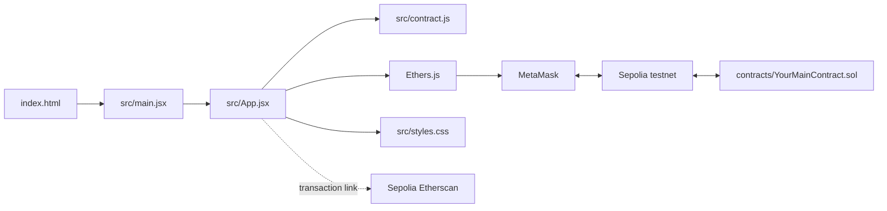

# DApp Template Folder Guide

This guide describes what the supplied DApp template should look like before and after the project is implemented. The current stage is idea and design, so the files should be understood before they are changed.

## 1. Final folder structure

The final source folder should normally look like this:

```text
dapp/
├── contracts/
│   ├── YourMainContract.sol
│   └── OtherContract.sol          # Optional: add when the DApp needs more than one contract
├── src/
│   ├── App.jsx
│   ├── contract.js
│   ├── main.jsx
│   ├── styles.css
│   └── components/                # Optional: add when App.jsx becomes too large
│       ├── WalletButton.jsx       # Optional
│       └── FeaturePanel.jsx       # Optional
├── .env.example
├── .gitignore
├── index.html
├── package.json
├── package-lock.json
└── README.md
```

The starter repository currently contains `contracts/TicketNFT.sol`. If the project idea is different from the tutorial NFT example, replace that contract with the contract or contracts required by the project. The exact contract names depend on the final design.

The local working folder also needs a `.env` file after deployment, but it is intentionally ignored by Git and is not part of the committed final source tree:

```text
dapp/.env
```

## 2. Relationship between the files



The flow is:

1. `index.html` provides a `<div id="root">` container.
2. `src/main.jsx` starts React and mounts `<App />` into that container.
3. `src/App.jsx` displays the interface and responds to user actions.
4. `src/App.jsx` imports the contract address and ABI from `src/contract.js`.
5. Ethers.js connects the React application to MetaMask and the blockchain.
6. MetaMask provides the user's public account and signs state-changing transactions.
7. The deployed Solidity contract enforces the business rules and stores blockchain state.
8. `src/styles.css` controls the appearance of the React interface.

## 3. What each existing file is used for

| File | Role |
| --- | --- |
| `contracts/TicketNFT.sol` | Solidity smart contract. It defines the on-chain rules, state variables, and functions. Replace or redesign it for the actual project idea. |
| `src/App.jsx` | Main React component. It contains the user interface, wallet connection logic, read calls, transaction functions, status messages, and button handlers. |
| `src/contract.js` | Web3 configuration. It provides deployed contract addresses, ABI definitions, the Sepolia chain ID, and the Sepolia Etherscan URL. |
| `src/main.jsx` | React entry point. It imports `App` and renders it inside the root element in `index.html`. |
| `src/styles.css` | CSS used to style the page, cards, buttons, status text, and responsive layout. |
| `index.html` | Minimal HTML shell. It contains the root element and loads `src/main.jsx`. |
| `package.json` | Project metadata, npm scripts, and direct dependencies such as React, Vite, and Ethers.js. |
| `package-lock.json` | Exact dependency versions used by npm. Keep it synchronized when dependencies are changed. |
| `.env.example` | Safe configuration template. It documents the environment variable name without containing a real deployment address. |
| `.gitignore` | Lists local, generated, and sensitive files that must not be committed. |
| `README.md` | Project instructions, deployment steps, architecture explanation, and testing notes. |

## 4. Existing files to modify

### `contracts/TicketNFT.sol`

Modify the entire contract when the project's idea is different from the ticket example. Define the required data, functions, access rules, events, and validation in Solidity. If the design needs several independent contracts, add separate `.sol` files under `contracts/`.

### `src/App.jsx`

Modify the application logic and interface for the project's features. The placeholder sections in the supplied template must be completed or replaced. Add the functions that connect buttons to contract calls, for example wallet connection, token transfer, NFT purchase, withdrawal, or other project-specific operations.

### `src/contract.js`

Change the deployed address and ABI after the Solidity contract is compiled and deployed. The address is normally read from `.env`:

```javascript
export const CONTRACT_ADDRESS = import.meta.env.VITE_CONTRACT_ADDRESS ?? "";
```

Replace the sample ABI entries with the functions and events that the frontend actually calls:

```javascript
export const CONTRACT_ABI = [
  "function yourFunction(...) ...",
  "function yourReadFunction(...) view returns (...) ",
  "event YourEvent(...)"
];
```

If the DApp uses several contracts, add one address and one ABI for each contract. The ABI is obtained from compilation; the address is obtained from deployment. They do not update automatically unless the team creates a deployment script to update this file.

### `.env.example` and local `.env`

Keep `.env.example` safe and descriptive:

```env
VITE_CONTRACT_ADDRESS=0xYourDeployedContractAddress
```

Create `.env` locally and replace the placeholder with the real Sepolia address:

```env
VITE_CONTRACT_ADDRESS=0x...
```

For multiple contracts, add variables such as `VITE_CPT_ADDRESS` and `VITE_NFT_ADDRESS`. Do not put private keys, seed phrases, or API secrets in either file.

### `src/styles.css`

Modify the CSS if the DApp needs a different visual design. This file does not change contract behavior.

### `README.md`

Update the project name, feature description, deployment instructions, contract names, and testing steps once the project design is fixed.

### Files that usually need only small changes

- `index.html`: change the page title, description, or other metadata if needed. Keep the root element and `src/main.jsx` script.
- `package.json`: add a dependency only when the project actually needs a new library. Keep the existing Vite, React, and build scripts unless there is a clear reason to change them.
- `src/main.jsx`: normally leave it unchanged. Modify it only if the application needs a different entry setup or additional top-level providers.
- `package-lock.json`: do not edit by hand. Run npm after changing `package.json` so npm updates it.
- `.gitignore`: change only if a new local or generated file needs to be excluded.

## 5. Files and folders created automatically

These are generated during normal development and do not need to be written manually:

| Generated item | Created by | Purpose |
| --- | --- | --- |
| `node_modules/` | `npm install` or `npm ci` | Installed JavaScript dependencies. Do not edit or commit it. |
| `dist/` | `npm run build` | Production static files generated by Vite. Do not edit the source through this folder. |
| Vite cache files | Vite during development or build | Temporary build information. They are normally covered by the ignore rules. |

`.env` is different: it is not generated automatically by Vite. The team creates it manually by copying `.env.example` and inserting the deployed contract address. It remains local because `.gitignore` excludes it.

The blockchain also creates deployment transactions, transaction receipts, token IDs, and event logs. These are blockchain records, not files that should be added to the project folder.

## 6. Files to add at the final stage

The required final source files are already represented by the template. The project may need these additions depending on its design:

1. **Project-specific Solidity contracts**

   Add new files under `contracts/` when the DApp needs more contracts than the supplied `TicketNFT.sol`, for example:

   ```text
   contracts/
   ├── ClubPointToken.sol
   └── CampusMemoNFT.sol
   ```

2. **Optional React components**

   Add files under `src/components/` only if splitting `App.jsx` makes the interface easier to maintain.

3. **Optional static assets**

   Add images, icons, or other frontend assets in a clearly named folder such as `src/assets/` if the final interface needs them.

4. **Project documentation**

   Update the existing `README.md`. Add separate documentation files only when the course submission requires them.

Do not add `node_modules/`, `dist/`, or the local `.env` to the submitted source repository.

## 7. Recommended implementation order

Because the project is currently at the idea stage, use this order:

1. Define the DApp's users, features, data, and business rules.
2. Decide which rules must be enforced on-chain.
3. Design and implement the Solidity contract or contracts.
4. Compile and test the contracts in Remix.
5. Deploy the final contracts to Sepolia and record their addresses.
6. Update `src/contract.js` and the local `.env` with the addresses and ABIs.
7. Implement the React features in `src/App.jsx`.
8. Adjust `src/styles.css` and add components or assets if necessary.
9. Run `npm run build` and test the complete wallet-to-contract flow on Sepolia.
10. Commit source files and documentation while leaving generated folders and `.env` ignored.

## 8. Note about the supplied `.git` folder

The `.git` folder inside `final project/dapp` belongs to the template provider, as noted by the team. It should not be treated as the team's remote repository. Do not use it to infer the team's GitHub destination. If the project is later placed in the team's repository, follow the team's agreed repository setup separately and keep the template's source files as the working content.
